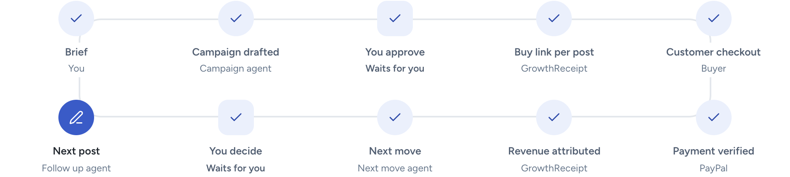
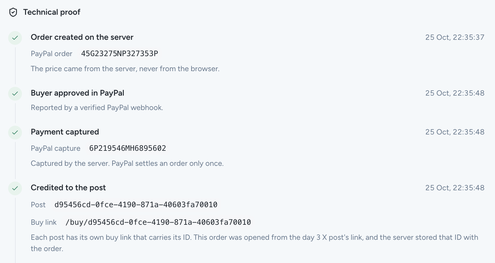
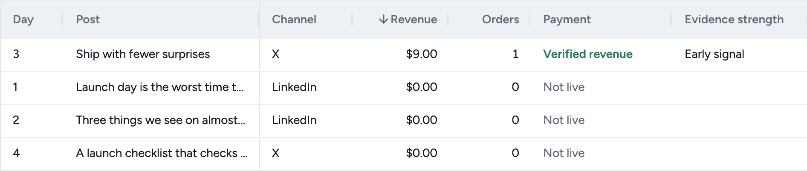
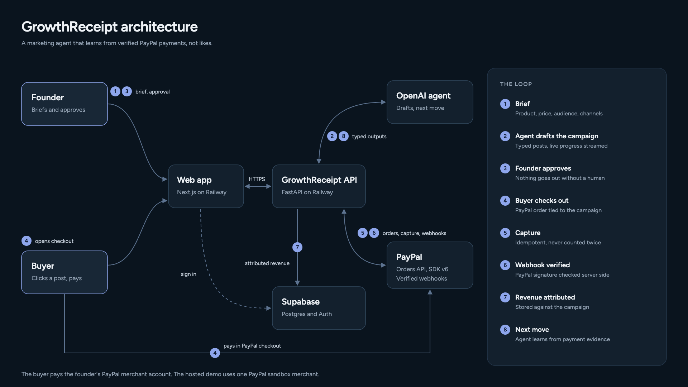

# GrowthReceipt

The marketing posts that drive sales, and what to post next. GrowthReceipt is a marketing agent for indie founders and small teams selling digital products. Each approved marketing post gets its own PayPal buy link, PayPal verifies every purchase, and the agent plans the next post from those verified purchases. Nothing changes until the founder approves it.

Entry for the 2026 PayPal AI Hackathon. Live at **https://growthreceipt.addisstack.com**.

## Judge path in 60 seconds

1. Open https://growthreceipt.addisstack.com and choose **Try the judge demo**. No sign up. A guided tour walks the loop.
2. In **Customer checkout**, choose **Open as customer** and pay with the sandbox buyer shown on the page. It is the PayPal sandbox, so no real money moves.
3. Back in the workspace, **Results** shows the verified revenue credited to the post. Open **Technical proof** for the order, the capture and the verified webhook.
4. Choose **Find next move**. The agent reads the verified purchase and proposes one experiment that waits for your approval.

The home page also has **Play the revenue loop**, a walk through every stage in about 20 seconds.



| PayPal proves which post paid off | Posts ranked by verified revenue |
| --- | --- |
|  |  |



* How the loop works and who pays whom: [docs/hackathon/architecture.md](./docs/hackathon/architecture.md)
* Common judge questions: [docs/hackathon/judge-faq.md](./docs/hackathon/judge-faq.md)
* Who it is for and planned pricing: [docs/hackathon/who-its-for.md](./docs/hackathon/who-its-for.md)
* Five slide summary: [docs/hackathon/deck/growthreceipt-deck.pdf](./docs/hackathon/deck/growthreceipt-deck.pdf)

Built with PayPal Orders, Web SDK v6 and verified webhooks, OpenAI agents with human approval, Next.js, FastAPI and Supabase.

## Tests

```bash
pytest -q apps/api                                           # API tests
E2E_BASE_URL=https://growthreceipt.addisstack.com npx playwright test   # hosted browser tests
```

The hosted suite also runs daily from `.github/workflows/smoke.yml`. Add `E2E_PAYPAL=1 --grep @paypal` for a real PayPal sandbox purchase and refund.

## Background

The repository started as a broader approval first marketing system: brief to campaign, platform specific content, human approval, scheduling, measurement and evidence backed lessons. GrowthReceipt is the payment backed slice of it built for the hackathon. The original plan lives in [SPEC.md](./docs/background/SPEC.md) and [ARCHITECTURE.md](./docs/background/ARCHITECTURE.md). Parts of it, such as Buffer scheduling, Telegram and Stripe, were never built.

## Current implementation

```text
apps/web              Next.js campaign review workspace
apps/api              FastAPI and agent/job interfaces
supabase              Local configuration and migrations
docs/background       Original pre hackathon plan, kept as background
```

### Local setup

```bash
cp .env.example .env
make setup
make db-up
make demo-seed
make dev-api
make dev-web
```

`make demo-seed` applies migrations and loads the judge demo campaign. `make demo-reset` deletes the demo workspace campaigns and PayPal orders, then reseeds. Both refuse to run when `APP_ENV=production`.

Use separate terminals for the API and web commands. The API runs on port 8000 and the web app on port 3000 by default. If port 3000 is taken, run the web app on 3001 (`npm run dev:web -- -p 3001`), the port the LinkedIn redirect and Playwright use locally.

For local PayPal webhooks, start the restricted relay and a fixed ngrok endpoint in two more terminals. Set `NGROK_URL` to your reserved ngrok https URL first:

```bash
make dev-paypal-relay
make dev-paypal-tunnel
```

The tunnel always uses `$NGROK_URL/v1/paypal/webhooks`, so the PayPal sandbox webhook configuration does not need to change after restarts. Only the webhook route is exposed by the relay. Other paths return `404`.

### Implemented API slices

- `POST /v1/campaigns` turns a product brief into a typed campaign through an OpenAI-hosted agent session and persists it for review.
- `POST /v1/campaigns/stream` does the same and reports each step the agent reaches as server-sent events (`progress`, then `campaign` or `error`). The web app uses this route.
- `GET /v1/campaigns/latest` and `GET /v1/campaigns/{campaign_id}` load a campaign with its posts.
- `PATCH /v1/campaigns/{campaign_id}/posts/{post_id}` edits a post, approves it, or requests changes with a note. Edited text always needs a fresh approval.
- `POST /v1/campaigns/{campaign_id}/approve` approves every post in the campaign.
- `GET /v1/campaigns/{campaign_id}/events` returns the audit history of agent outputs and human decisions.
- `POST /v1/agents/campaign-draft` returns a typed campaign draft without saving it.
- `POST /v1/paypal/orders` creates an attributed PayPal order from a server-owned offer. The campaign and post must exist.
- `POST /v1/paypal/orders/{order_id}/capture` captures an approved order and normalizes its result.
- `POST /v1/paypal/webhooks` verifies the PayPal signature before accepting an event.
- `GET /v1/paypal/config` exposes only the browser-safe sandbox client configuration.
- `GET /v1/paypal/revenue/{campaign_id}` returns persisted, attributed revenue evidence.
- `POST /v1/agents/follow-up-post` drafts the one post an approved next move asks for, built on the post that earned the revenue. It waits in review.
- `POST /v1/agents/next-action/decision` records the founder approving, editing or rejecting the latest next move. Nothing runs without it.
- `GET /v1/paypal/receipts/{campaign_id}` returns each completed purchase with its post, order and capture IDs, and the signature verified PayPal webhooks that match it.
- `POST /v1/agents/next-action` loads the stored campaign, turns normalized PayPal revenue into one approval-gated experiment, and records it in the campaign history.
- `GET /v1/workspace/settings` and `PATCH /v1/workspace/settings` read and save the workspace name and time zone. The time zone must be a known IANA zone, and null follows each viewer's browser.

Until PayPal sandbox credentials are configured, PayPal routes return `503`. Tests use an explicit fake adapter. The application never treats placeholder credentials or fake responses as payments.

### PayPal sandbox checkout

Approved posts also get **Open in LinkedIn** or **Open in X**. It opens that channel's official share composer with the post and its buy link filled in, and the founder presses Post. With LinkedIn connected, GrowthReceipt can also post approved LinkedIn posts for the founder, as described in LinkedIn publishing below. Facebook's sharer takes only the link, so the text is copied for pasting, and Instagram gets a copy button because it has no web composer.

Approve a post, then select **Make a test purchase** or open **Customer checkout**. Each approved post has a public buy page at `/buy/{post id}` that needs no sign in. It loads PayPal Web SDK v6, checks PayPal eligibility, creates the order through the public API (`/v1/public/...`), captures it after approval, and shows the receipt. The server resolves the campaign from the post and refuses posts that are not approved. Use a Personal account from PayPal's Sandbox Accounts page. Set `PAYPAL_SANDBOX_BUYER_EMAIL` and `PAYPAL_SANDBOX_BUYER_PASSWORD` to show that login on the buy page, which is how judges pay on the hosted demo. The API only shares them in sandbox mode. No real money moves in sandbox mode.

### LinkedIn publishing

Founders can connect their own LinkedIn profile under Integrations. GrowthReceipt then posts approved LinkedIn posts, with their attributed buy link, either on a confirmed **Post to LinkedIn now** click or automatically on the post's scheduled day from 9:00 in the workspace time zone. Automatic posting only covers approved posts dated on or after the day it was turned on. Nothing in review is ever posted.

It uses LinkedIn's self serve products, Sign In with LinkedIn using OpenID Connect and Share on LinkedIn (`openid profile w_member_social`), and posts through `POST https://api.linkedin.com/v2/ugcPosts`.

- `GET /v1/integrations/linkedin` returns whether LinkedIn is configured and connected, the member name, token expiry and the auto publish choice.
- `POST /v1/integrations/linkedin/authorize` returns the LinkedIn sign in URL with a signed state for this workspace.
- `POST /v1/integrations/linkedin/connect` finishes the sign in. LinkedIn redirects to the web app at `/integrations/linkedin/callback`, and the signed in web app sends the code here, so a forged callback cannot attach a LinkedIn profile to another workspace.
- `PATCH /v1/integrations/linkedin` turns automatic posting on or off. `DELETE /v1/integrations/linkedin` revokes the token and forgets it.
- `POST /v1/integrations/linkedin/posts/{post_id}/publish` posts one approved, unpublished LinkedIn post. A published post can no longer be edited.

Setup (full runbook with every form value in [docs/integrations/linkedin.md](./docs/integrations/linkedin.md)):

1. Create an app at https://www.linkedin.com/developers/apps (it must be linked to a LinkedIn Page), then add the **Sign In with LinkedIn using OpenID Connect** and **Share on LinkedIn** products.
2. Under Auth, add the redirect URLs `https://growthreceipt.addisstack.com/integrations/linkedin/callback` and `http://localhost:3001/integrations/linkedin/callback`.
3. Run `supabase/migrations/20261011000100_linkedin_publishing.sql`.
4. Set `LINKEDIN_CLIENT_ID`, `LINKEDIN_CLIENT_SECRET` and `LINKEDIN_TOKEN_KEY` on the API. Generate the key with `python -c "from cryptography.fernet import Fernet; print(Fernet.generate_key().decode())"`. It encrypts stored tokens, so changing it means every workspace reconnects. `WEB_ORIGIN` must be the web app's address, because the redirect URL is built from it.

Without these variables the Integrations page keeps the share link behaviour. LinkedIn access tokens last 60 days and self serve apps get no refresh token, so the founder reconnects when the Integrations page says the connection expired. The API checks for due posts every five minutes, and a claim column stops two replicas from posting the same item.

## Security notes

- PayPal webhooks are accepted only after PayPal verifies the signature. Each event ID is stored once, so a repeated notification never counts revenue twice.
- Revenue counts only completed captures. A pending capture is not revenue, and a fully refunded purchase leaves the evidence.
- The buy link decides the attribution and the price on the server. It resolves the post, campaign and offer, and refuses posts that are not approved.
- Every query is scoped to the signed in workspace, and the Supabase tables have row level security on.
- The agent's PayPal tool only accepts order IDs from the campaign's own paid receipts. Human approval of a next move is enforced by the API, not only the interface.
- The page reader fetches only https pages on public addresses, checks each redirect, and caps size and time.
- LinkedIn tokens are encrypted at rest, and the sign in state is signed so a forged callback cannot attach a profile to another workspace.
- Secrets live in environment variables and never in the repository. The sandbox buyer login is shared only in sandbox mode. The full git history was scanned with `gitleaks`.
- Agent runs have daily limits per workspace and in total.

## Known limitations

- PayPal sandbox only. Buyers pay one GrowthReceipt sandbox merchant. Founders connecting their own PayPal account is planned.
- Only purchases made through a post's buy link are attributed. A purchase that skips the link is not credited to any post.
- One time purchases only. Subscriptions are planned.
- The agent picks offers from a fixed catalog, not from the founder's own products.
- Automatic posting covers LinkedIn personal profiles. X and Facebook open the official share composer, Instagram gets a copy button, and views and clicks are not imported.
- Small samples stay small. Fewer than 3 purchases on the leading post is labeled an early signal, and the agent is told not to call a winner. When one post earns the most but another has more purchases, the evidence is labeled mixed and the agent compares the two.
- LinkedIn self serve tokens last 60 days with no refresh, so founders reconnect.

## Documents

- [docs/hackathon/judge-faq.md](./docs/hackathon/judge-faq.md) answers common questions: attribution, wrong recommendations, why PayPal, agent data, run cost and refunds.
- [docs/hackathon/whats-next.md](./docs/hackathon/whats-next.md) describes what comes next: subscriptions, direct payouts to founders, offers from the founder's products and more publishing channels.
- [docs/hackathon/architecture.md](./docs/hackathon/architecture.md) shows the architecture diagram, the eight step loop, and the payment model.
- [docs/hackathon/who-its-for.md](./docs/hackathon/who-its-for.md) describes the target user, the issue they have, and the planned pricing.
- [docs/integrations/linkedin.md](./docs/integrations/linkedin.md) is the LinkedIn setup runbook: app form values, which products to request, redirect URLs, Railway variables, token renewal and open gaps.
- [SPEC.md](./docs/background/SPEC.md), [ARCHITECTURE.md](./docs/background/ARCHITECTURE.md) and [PROMPTS.md](./docs/background/PROMPTS.md) are the original pre hackathon plan and build prompts, kept as background. They describe more than GrowthReceipt ships.
