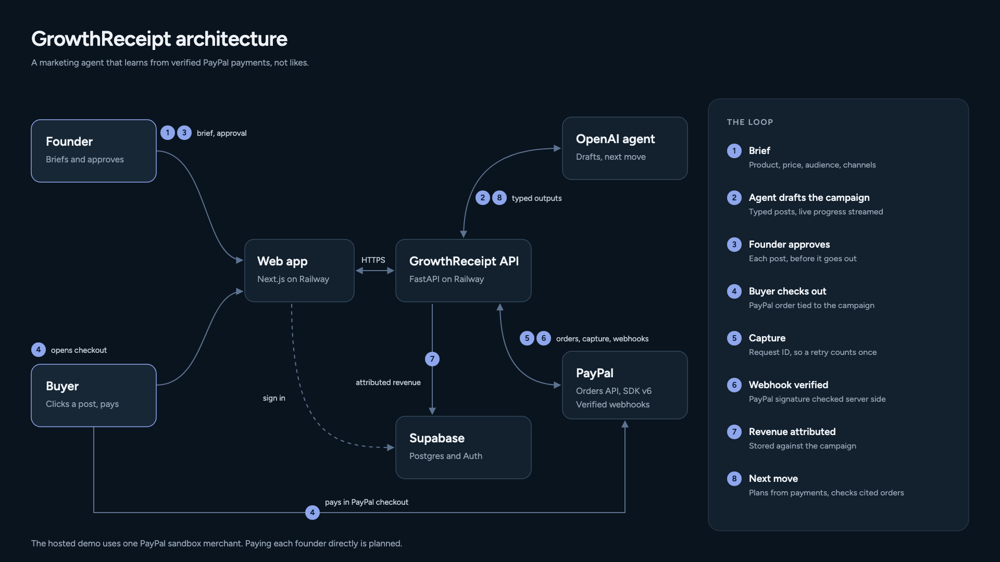
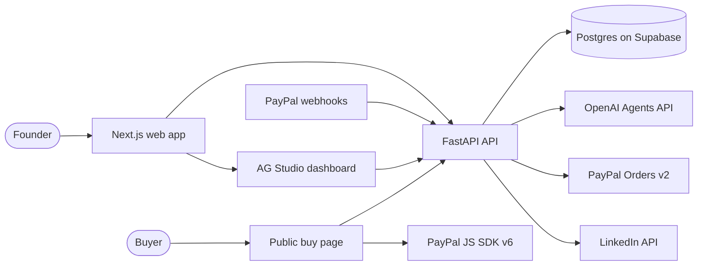
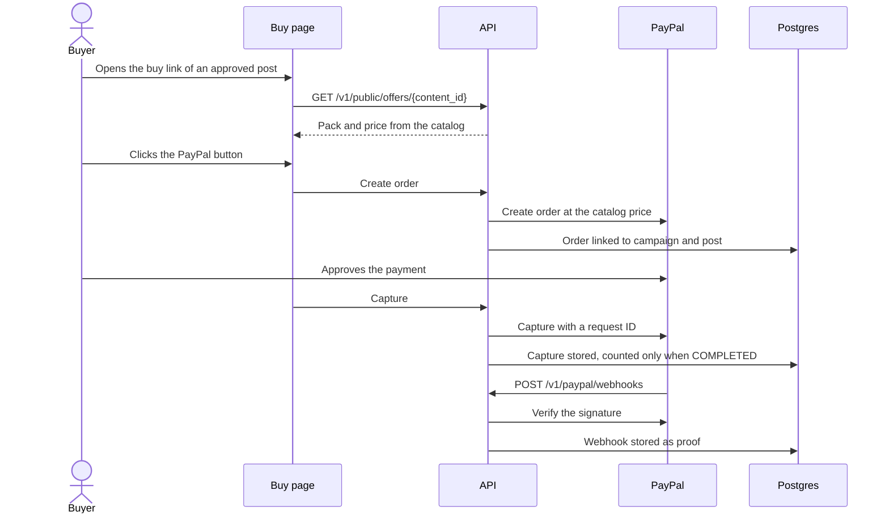
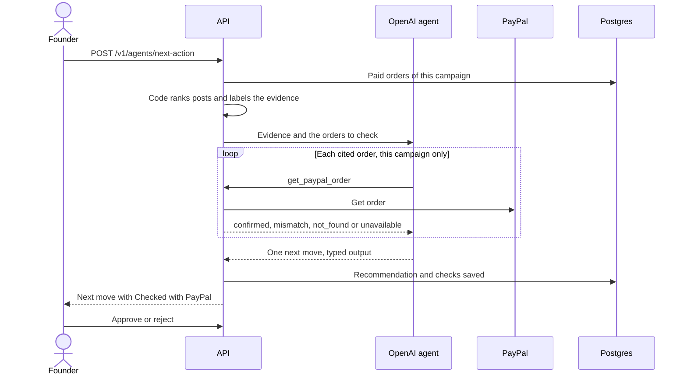
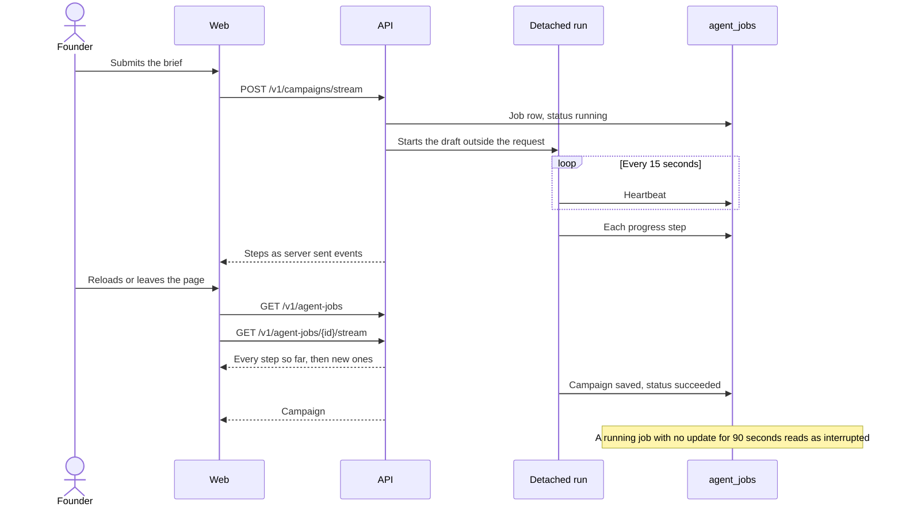
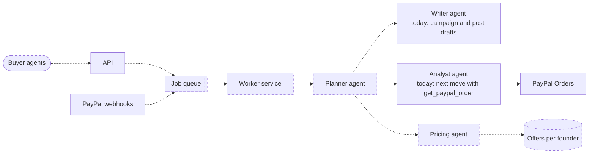

# GrowthReceipt architecture for judges

The source is [overview.svg](../architecture/overview.svg). The PNG is 1920 by 1080, so it can go straight into the demo video and the Devpost gallery.

## What the system does

GrowthReceipt is a marketing agent that learns from verified PayPal payments instead of likes. A founder briefs a product, the agent drafts a campaign, the founder approves it, buyers pay through a PayPal checkout tied to that campaign, and the agent plans the next move from the payments it can prove.

## The loop

1. **Brief.** The founder gives the product, price, audience and channels in the web app. They can also paste a link to the product page. The API reads that public page and the agent suggests the brief fields for the founder to edit. The API fetches only https pages on public addresses, checks every redirect the same way, and stops at 1 MB or 8 seconds. Page text goes to the model as data, never as instructions. A link that cannot be read does not count toward the daily agent limit.
2. **Agent drafts.** The API calls the OpenAI agent, which returns typed campaign output. Progress streams to the browser as each real step finishes.
3. **Founder approves.** Every post can be edited, and nothing goes out without approval. Each change is logged as a campaign event.
4. **Buyer checks out.** Each approved post carries a public buy link. The buyer opens it without signing in and never sees GrowthReceipt. The API finds the campaign from the post, refuses posts that are not approved, creates a PayPal order tied to that post, and the buyer pays in PayPal through the JavaScript SDK v6. Public order creation is limited to 20 an hour per address.
5. **Capture.** The API captures the order with a request ID, so a repeated capture is never counted twice.
6. **Webhook verified.** PayPal sends the capture event. The API checks its signature with PayPal before trusting it.
7. **Revenue attributed.** The captured amount is stored against the campaign in Postgres.
8. **Next move.** The agent reads the payment evidence and proposes one next action with its confidence. The founder approves it. Code, not the model, ranks the paying posts and labels the evidence: none, early signal (the leading post has fewer than 3 purchases), clear leader, or tie. A tie asks for a controlled comparison instead of a winner. Each recommendation shows the time of the latest purchase it read, and the Next experiment page flags new purchases that arrived after it.
9. **Offer switch.** Once there is at least one purchase, the agent may also suggest that the buy links sell a different pack from the catalog. Code drops any suggestion that is not in the catalog or matches the current pack. The founder sees "Switch the buy link offer from X to Y" and can approve the plan with or without the switch. An approved switch is saved as an `offer_changed` campaign event, the latest one decides what every buy link sells, and Results splits revenue by offer. The agent cannot invent an offer or a price. The founder can also pick the pack by hand on the Checkout page, which saves the same event.

## Diagrams

Each diagram is drawn from the code. A change to one of these flows updates its diagram in the same commit. GitHub renders them, and PNG copies for Devpost are in [docs/architecture/](../architecture/).

### System

### Purchase and proof

### Next move checked with PayPal

### Campaign draft that survives a reload

## Who pays whom

The PayPal payment is a buyer paying the founder for the founder's product. It is not a fee for using GrowthReceipt.

In the demo, Teklie Belay, the maker of GrowthReceipt, promotes LaunchCheck (launchcheck.addisstack.com), a scanner Teklie also built that finds launch issues on a public page. The offers are LaunchCheck's real one time scan packs: 3 scans for 4 USD, 10 scans for 9 USD and 30 scans for 19 USD. A campaign starts on the 10 scan pack. A buyer who arrives from a campaign post buys the pack the campaign sells, and GrowthReceipt credits that revenue to the campaign. LaunchCheck takes card payments through Stripe on its own site, and in the demo customers buy the same pack through PayPal.

GrowthReceipt's own pricing is separate from that payment. It is planned as a 3% fee on verified revenue, collected through the same PayPal split described below, or a monthly plan with no fee. See [who-its-for.md](./who-its-for.md).

### How the money moves in the hosted demo

No real money moves, and the founder receives nothing. The demo exists to prove the attribution loop.

1. The buyer opens a post's buy link and clicks the PayPal button.
2. The API creates a PayPal order with GrowthReceipt's sandbox credentials. The payee is one PayPal sandbox merchant account that GrowthReceipt owns.
3. The buyer approves the payment and the API captures it. The sandbox money lands in that one account.
4. PayPal sends the capture webhook, the API verifies it, and the revenue is credited to the campaign and the post.

The checkout sells the campaign's current pack from the catalog in `apps/api/app/offers.py`. Posts written before a switch keep their text, so the buy page always shows the pack and price the buyer pays.

### How the money moves in production (planned, not built)

1. **Connect PayPal.** The founder goes through PayPal partner onboarding (the Partner Referrals API), signs in to their own PayPal business account and grants permission. GrowthReceipt stores their PayPal merchant ID.
2. **Create the order.** At checkout the API creates the order as the platform, with `payee.merchant_id` set to the founder's ID.
3. **Payment.** The money goes straight into the founder's PayPal balance, less PayPal's usual processing fee. GrowthReceipt does not hold or forward the money.
4. **Revenue fee, Starter plan only.** The order carries a `platform_fees` entry for 3%. PayPal splits it out at capture and sends that share to GrowthReceipt's account. Maker and Team plans have no platform fee.
5. **Attribution.** PayPal still sends GrowthReceipt the order and capture webhooks, so attribution works exactly as in the demo.
6. **Withdrawal.** The founder moves money from PayPal to their bank the normal way. Refunds and disputes stay in their own PayPal account.

What is missing to get there:

* The Connect PayPal onboarding flow
* Storing each founder's merchant ID
* Setting the payee and the platform fee on each order
* PayPal partner approval for multiparty payments, which can take weeks. This is the main blocker and the reason the demo uses one merchant.

## Where the agent goes next (planned, not built)

The homepage lists the product features planned next. This section is about how the agent system itself grows. Dashed boxes and arrows are planned. Solid ones exist today.

1. **More autonomy, in steps.** Today the agent suggests and the founder approves. Next, offers move into the database so the agent can propose a new pack or price within limits the founder sets. After that, an autopilot that acts inside a budget, with every action logged and reversible.
2. **Specialist agents.** A writer, an analyst that holds the PayPal tools and a pricing agent, coordinated by one planner. Buyer agents could also buy through the same verified checkout, which opens a new sales channel.
3. **Scale.** Agent runs already live in the `agent_jobs` table, so a page can reattach after a reload. The runs still execute inside the API process. The next step moves them to a job queue served by the worker service (`services/worker`, a stub today), takes PayPal webhooks in through the same queue, and runs several API copies. The per workspace and global agent limits already exist.
4. **Deeper PayPal use.** Partner onboarding so founders are paid directly (see the production money flow above), PayPal Subscriptions, and refunds and disputes in the proof chain, so a refunded purchase stops counting as evidence.
5. **Measuring the agent.** Check each past recommendation against the purchases that came after it, and run split tests with a minimum sample size before a winner is called.

## Hosting

| Part | Where |
| --- | --- |
| Web app | Next.js on Railway, `growthreceipt.addisstack.com` |
| API | FastAPI on Railway, `growthreceipt-api.addisstack.com` |
| Database and sign in | Supabase Postgres and Auth, tables in the `growthreceipt` schema |
| Agent | OpenAI, called only from the API |
| Payments | PayPal sandbox Orders API, JavaScript SDK v6 and webhooks |

Judges enter with one click. Each judge gets an anonymous session and a private seeded workspace.

Model calls are capped. Each workspace can run the agent 20 times a day, and all workspaces together 300 times a day. The API records every run in `growthreceipt.agent_runs` and answers 429 with a plain message once a limit is reached. Both limits are settings (`AGENT_RUNS_PER_WORKSPACE_DAY`, `AGENT_RUNS_PER_DAY`).

Releases go through `dev`. CI runs the web checks, the API checks and both production images. When all pass on a `dev` push, CI fast forwards `main` to that commit, and Railway deploys from `main`. The source lives in the private repository `tekbel/growthreceipt` until the submission audit makes it public. Manual `railway up` deploys are retired.

## Using it in the demo video

Show the diagram for about ten seconds right after the opening problem statement. Point at the numbered loop on the right, then cut to the live product and follow the same numbers in order.
